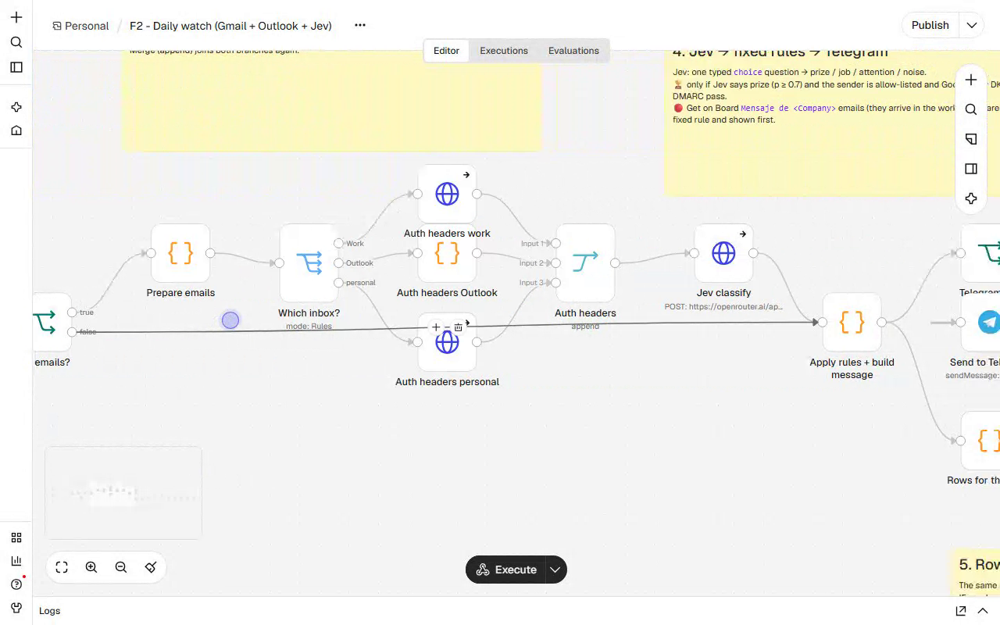
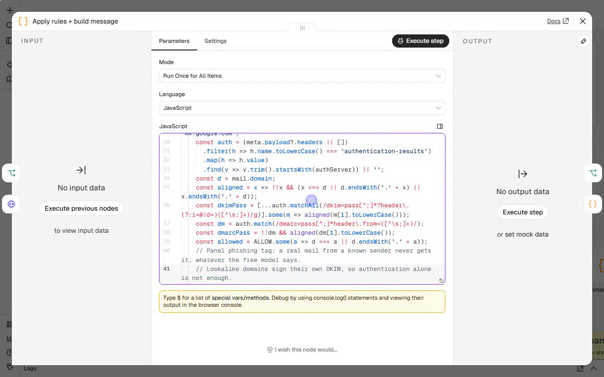
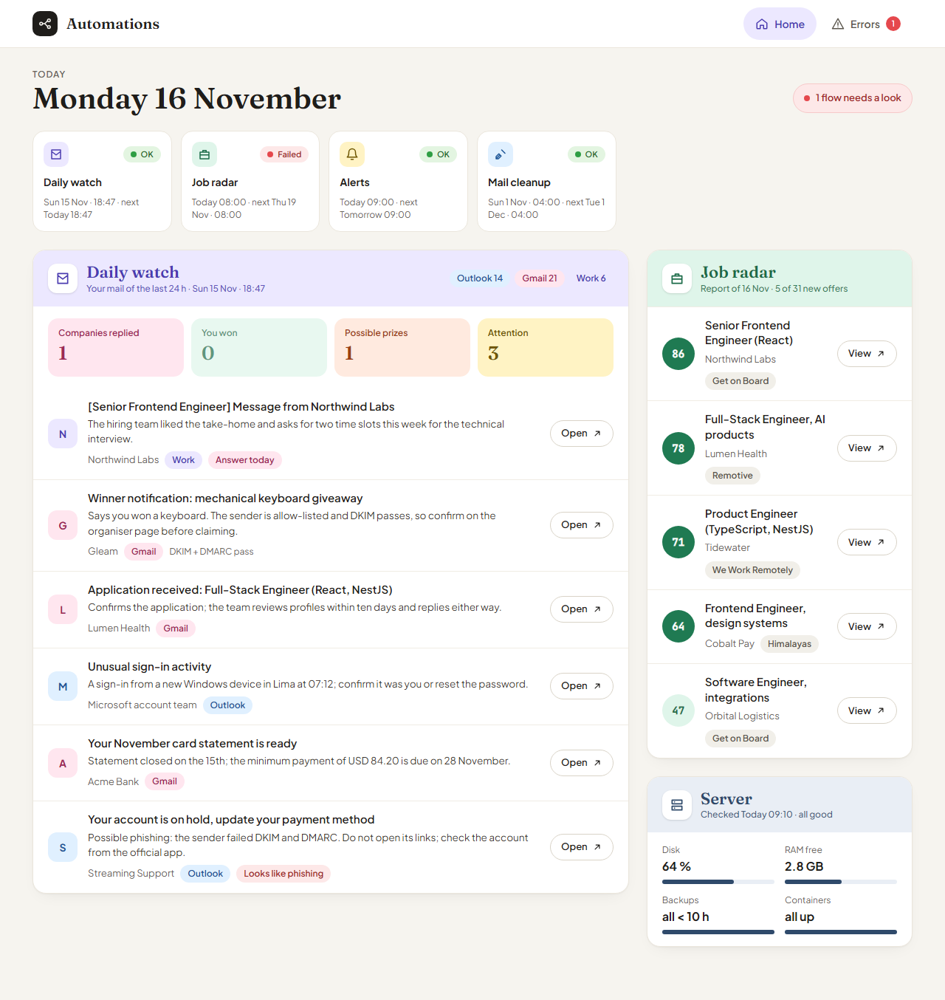

# n8n automations

A self-hosted [n8n](https://n8n.io) instance that runs my daily automations, and the small web panel where I read
their results. It has been in production since November 2026 on an ARM VM, next to two other products.



This repository is a **curated public copy** of the private one: real workflows and code, without personal data.
Mailbox addresses, chat ids, hosts and credential names are placeholders, and two personal flows (a giveaway radar
and a social-media promo watcher) are left out.

## What runs

| Flow | When (Lima) | What it does |
|---|---|---|
| **Daily watch** | Daily 18:47 | Reads four mailboxes (Gmail ×2, Outlook through Microsoft Graph, one forwarded). A typed LLM sorts each mail; **fixed rules decide**; a free model writes a one-line summary per mail for the panel |
| **Job radar** | Mon + Thu 08:00 | Screens the postings found by a separate radar engine plus LinkedIn alert emails, drops the ones the model is almost sure fail a red line, and writes a finalists report |
| **Mail cleanup** | Day 1, 04:00 | Moves mail older than a year to Trash / Deleted Items, paged, batched and paced under each provider's limits |
| **Alerts** | On error + daily 09:00 | Error workflow of every other flow, plus a daily health check of the VM (backups, disk, RAM, containers) |

```
Gmail · Outlook (Graph) · radar files ──▶ n8n ──▶ typed LLM sorts ──▶ fixed rules decide ──▶ Data table
                                                                                         └──▶ Telegram (errors only)
                                 panel (NestJS + React) ◀── n8n public API ◀────────────────┘
everything behind Cloudflare Tunnel + Zero-Trust Access
```

## Decisions worth reading

- [The LLM sorts, fixed rules decide](n8n/docs/adr/0005-llm-sorts-rules-decide.md): the input is written by strangers,
  so the model answers typed questions and code makes the call.
- [Trust only the header written by the receiving provider](n8n/docs/adr/0003-trust-provider-auth-header.md): a "you won"
  needs DKIM + DMARC in the `Authentication-Results` header that Gmail or Outlook wrote, not the sender.
- [Outlook through Microsoft Graph with least privilege](n8n/docs/adr/0001-outlook-via-microsoft-graph.md), and the
  [three options that were discarded](n8n/docs/adr/0002-outlook-alternatives-discarded.md).
- [The panel has no database](docs/adr/0001-n8n-as-system-of-record.md): n8n is the system of record.



## The panel



Status of every flow, the latest daily watch, the latest job radar report, server health, and an Errors page whose
report carries everything needed to fix a failure (node, message, stack, the node's input with secrets redacted).

Run it without n8n, on invented data:

```sh
pnpm install
pnpm demo          # builds, starts a fake n8n API and the real NestJS API + React build → http://localhost:3110
```

Only the far end of the adapters is fake (`scripts/demo/fake-n8n.mjs`); every use case, contract and component is the
real one.

## Repository

| Path | What it is |
|---|---|
| `n8n/workflows/build_*.py` | Each workflow generated from Python (credentials are referenced by id, never included) → `*.json` |
| `n8n/docker-compose.yml`, `n8n/scripts/` | n8n + Postgres, encrypted backups, health check, and scripts that load each secret over SSH stdin |
| `apps/api` | NestJS 11, hexagonal: domain → use cases and ports → adapters for the n8n API and the VM files |
| `apps/web` | React + Vite, TanStack Query, React Router, Tailwind 4 |
| `packages/contracts` | Zod schemas of every response, shared by API and web |
| `packages/ui` | Components by role, with Storybook and accessibility checks |
| `docs/`, `n8n/docs/` | Vision, features, architecture, ADRs and runbooks |

```sh
pnpm lint && pnpm typecheck && pnpm test && pnpm build
pnpm storybook
```

Import rules between layers are enforced by ESLint; CI runs lint, typecheck, tests, build, a secret scan and a check for
invisible Unicode on every push.

## How it was built

I designed the flows, the rules and the panel, and I review every result. The code was written with Claude Code from
the specs and decisions in `docs/`; I test it and answer for it.
